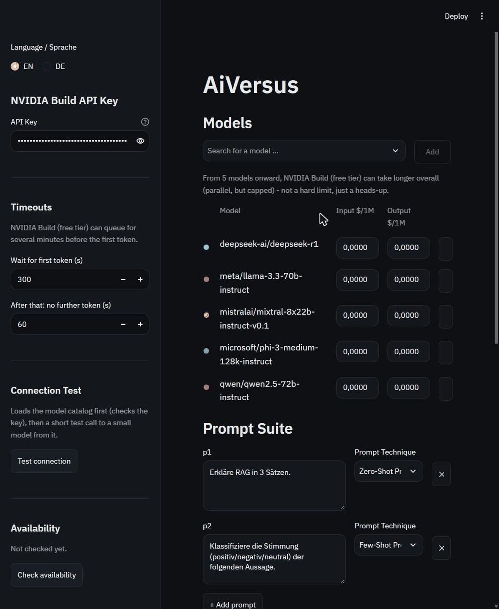
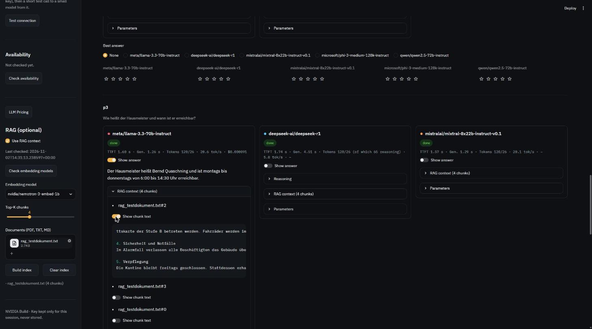
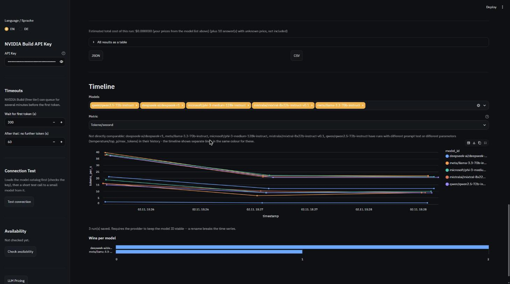

# AiVersus

AiVersus ist ein Open-Source-Tool, um große Sprachmodelle nebeneinander zu vergleichen.
Füge beliebig viele Modelle von [NVIDIA Build](https://build.nvidia.com) hinzu, lass
dieselben Prompts parallel gegen alle laufen und vergleiche Antworten, Zeiten, Tokens und
Kosten - optional mit eigenen Dokumenten als RAG-Kontext. Läuft lokal im Browser.

*(🇬🇧 English version: [README.md](README.md))*



## Funktionen

- **Beliebig viele Modelle nebeneinander** - im Live-Katalog von NVIDIA Build suchen,
  so viele Modelle wie gewünscht hinzufügen und wieder entfernen; jedes bekommt eine
  feste Farbe.
- **Parallele Benchmark-Läufe** mit Live-Statuszeile pro Modell/Prompt (Warteschlange,
  generiert, fertig, Fehler, Timeout, abgebrochen) und einem **Stop**-Button, der sauber
  abbricht - fertige Antworten bleiben erhalten, nichts bereits Gespeichertes geht verloren.
- **Metriken pro Antwort**: Zeit bis zum ersten Token (TTFT, inkl. NVIDIA-Warteschlange),
  reine Generierungszeit, Input-/Output-Tokens, Reasoning-Tokens (bei Reasoning-Modellen),
  Tokens pro Sekunde und Kosten - plus die tatsächlich gesendeten Parameter (lehnt ein
  Modell einen Parameter ab, z.B. `seed`, wird einmal ohne ihn wiederholt, sichtbar markiert).
- **Bewertung**: pro Prompt die beste Antwort markieren und 1-5 Sterne pro Antwort vergeben;
  beides wird mit dem Lauf gespeichert.
- **Timeline**: jeder Lauf wird lokal gespeichert (`runs.db`); Latenz, Tokens oder Kosten
  über mehrere Modelle und Läufe vergleichen, plus ein "Siege pro Modell"-Diagramm aus
  deinen Bewertungen.
- **Verfügbarkeitsprüfung**: ein Klick schickt einen Mini-Call an jedes Katalog-Modell und
  zeigt, welche für deinen Account aktuell tatsächlich erreichbar sind (gespeichert in
  `availability.json`).
- **LLM-Pricing-Tabelle**: deine eigene, editierbare Preisliste (`pricing.json`) - nur
  Preise, die du auf einer offiziellen Anbieter-Seite verifizieren kannst, mit Quelle und
  Datum; unbekannt bleibt unbekannt, nie stillschweigend "kostenlos".
- **RAG (optional)**: PDF/TXT/MD-Dokumente hochladen, lokaler Index (ChromaDB), Embeddings
  laufen ebenfalls über NVIDIA Build - kein zweiter Anbieter nötig.
- **Englische oder deutsche Oberfläche**, Englisch als Standard, umschaltbar in der Sidebar.
- **Dein API-Key verlässt nie deine Browser-Sitzung** - nicht geloggt, nicht auf Festplatte
  gespeichert, in keinem Export enthalten.

## Installation

Benötigt [uv](https://docs.astral.sh/uv/) und Python 3.11+.

```bash
uv sync
```

## Start

```bash
uv run streamlit run app.py
```

Trage deinen NVIDIA-Build-API-Key in der Sidebar ein (kostenlos erhältlich auf
[build.nvidia.com](https://build.nvidia.com) - das Freikontingent ist großzügig, aber
**rechne bei stark genutzten Modellen mit einer Warteschlange von bis zu mehreren Minuten**
vor dem ersten Token; die App ist darauf mit einem langen Standard-Timeout eingestellt,
der sich in der Sidebar anpassen lässt).

## Nutzung

1. API-Key eintragen, Verbindung testen, dann ein oder mehrere Modelle unter **Modelle**
   hinzufügen.
2. Einen oder mehrere Prompts in der **Prompt-Suite** schreiben. Die beiden
   mitgelieferten Standard-Prompts zeigen den Unterschied zwischen den
   Techniken-Etiketten: `p1` ist Zero-Shot (direkte Frage, keine Beispiele),
   `p2` ist echtes Few-Shot - eine Stimmungs-Klassifizierung (positiv/negativ/
   neutral) mit drei vorgemachten Beispielen, bevor das Modell die letzte,
   noch unmarkierte Aussage einordnen soll. Das Etikett nur setzen, wenn es
   zum jeweiligen Prompt wirklich passt.
3. Die gemeinsamen **Parameter** setzen (temperature, top_p, max_tokens - Standard 4096,
   bei sichtbarem "Abgeschnitten"-Badge auf einer Karte höher setzen -, optionaler
   System-Prompt, optional fixierter Seed).
4. **Benchmark starten** klicken. Ergebnisse erscheinen als Karten pro Prompt, sobald ein
   Modell fertig ist; die beste Antwort markieren und bei Bedarf Sterne vergeben.
5. Ergebnisse als CSV oder JSON exportieren, oder in der **Timeline** frühere Läufe ansehen.

## RAG (optional)

"RAG-Kontext verwenden" in der Sidebar aktivieren, ein Embedding-Modell aus dem Live-Katalog
wählen, Dokumente hochladen (PDF, TXT, MD) und den Index aufbauen. Die relevantesten
Abschnitte werden einmal pro Prompt (nicht einmal pro Modell) abgerufen und als Kontext
mitgegeben; jede Ergebniskarte zeigt, ob Kontext injiziert wurde und welche Abschnitte
verwendet wurden. Der Index liegt lokal in `rag_store/`.

## Screenshots

Screenshot-Dateien werden nicht eingecheckt (lokaler Zustand, wie `runs.db`). Die
Platzhalter unten sind genau die Dateinamen, die unter `docs/screenshots/` erwartet
werden - eine PNG mit diesem Namen dort ablegen ersetzt das kaputte Bild-Symbol.


*`overview.png` - die Hauptansicht: ein paar hinzugefügte Modelle, ein fertiger
Benchmark-Lauf mit Ergebniskarten.*


*`rag.png` - die RAG-Sidebar (Embedding-Modell-Prüfung, Indexaufbau) und eine
Ergebniskarte mit aufgeklappten abgerufenen Chunks.*


*`timeline.png` - der Timeline-Abschnitt: ein Metrik-Chart über mehrere Läufe plus das
"Siege pro Modell"-Diagramm.*

## Datenschutz

Dein API-Key liegt nur im Speicher der Browser-Sitzung, solange die App offen ist. Er wird
nie auf die Festplatte geschrieben, nie geloggt und erscheint in keinem Export (CSV/JSON)
und nicht in `runs.db`.

## Projektdateien

- `runs.db`, `rag_store/`, `availability.json` - lokaler, nutzerspezifischer Zustand, nicht
  eingecheckt.
- `pricing.json` - deine eigene, quellenbelegte Preisliste; wird eingecheckt, da es sich um
  Referenzdaten handelt, die mit dem Projekt mitgeliefert werden sollen (enthält aber nur
  selbst verifizierte Preise).

---

© 2026 Airdinsh (Erdinç Arslan) · Masterschool AI Engineering Track · MIT-Lizenz (siehe
[LICENSE](LICENSE))
📧 Signlab@gmx.de · 🌐 [Airdinsh.com](https://Airdinsh.com)
