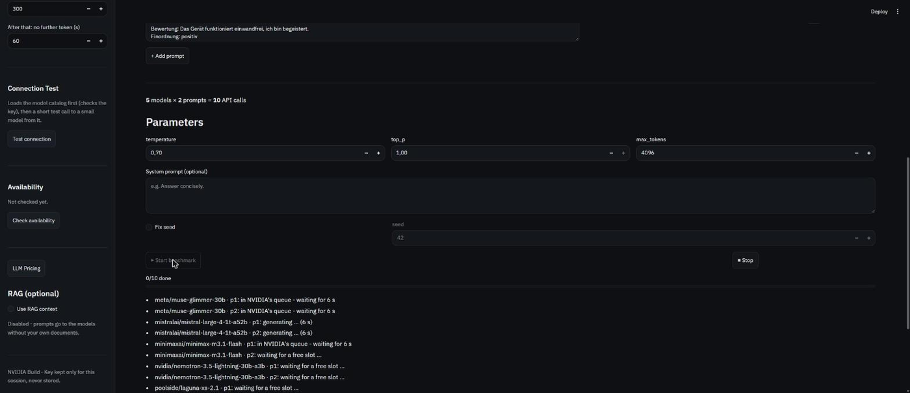
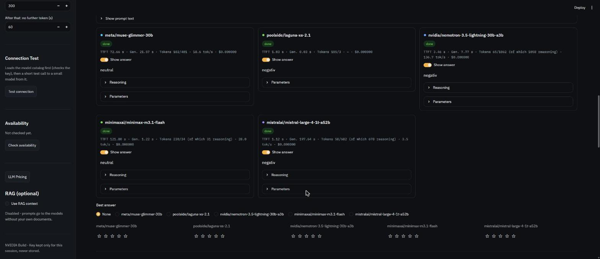
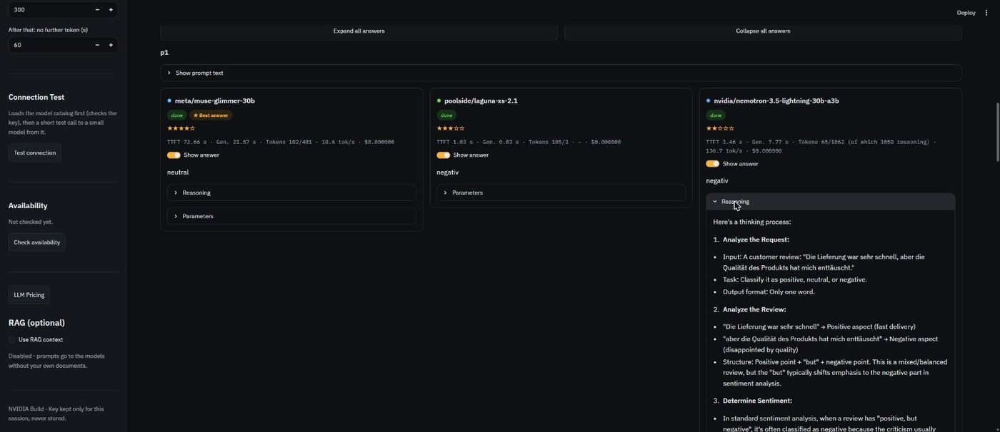
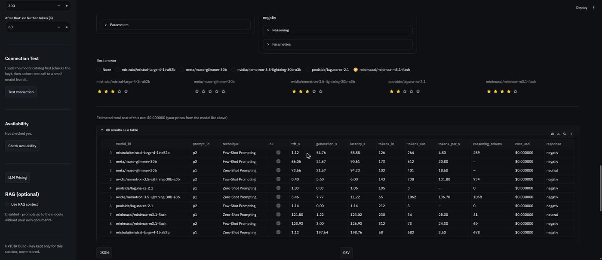
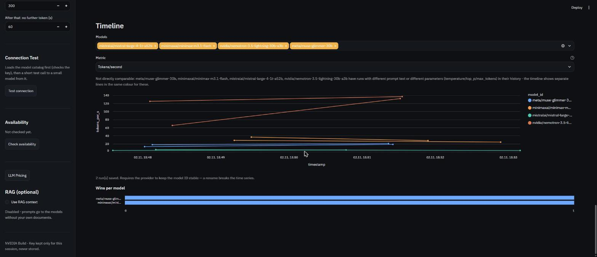
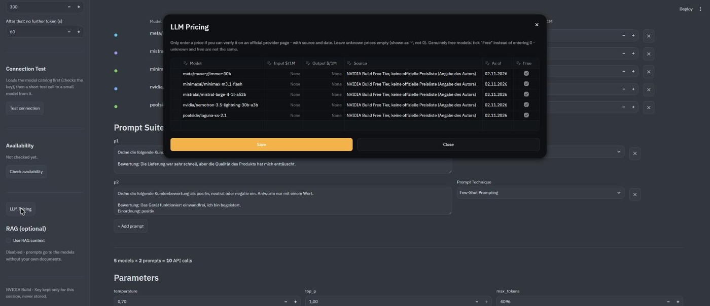
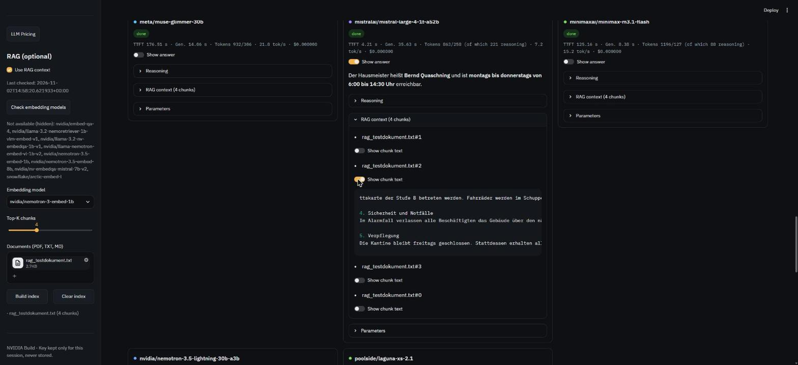

# AiVersus

AiVersus runs the same prompts against any number of [NVIDIA Build](https://build.nvidia.com) models in parallel and compares the answers, timing, tokens, and cost - optionally grounded in your own documents via RAG.

*(🇩🇪 Deutsche Version: [README.de.md](README.de.md))*


## Features

- **Any number of models, side by side** - search the live NVIDIA Build catalog, add as
  many models as you like, remove them again; each gets a stable colour.
- **Parallel benchmark runs** against the same prompts, with a live status line per
  model/prompt (queue, generating, done, error, timeout, cancelled) and a **Stop** button
  that cancels cleanly - finished answers are kept, nothing already saved is lost.
- **Metrics per answer**: time to first token (TTFT, includes NVIDIA's queue), pure
  generation time, input/output tokens, and tokens per second - plus the parameters
  actually sent (a model that rejects one, e.g. `seed`, is retried once without it, and
  that's shown).
- **Reasoning display**: models that return a separate reasoning/thinking trace show it
  in its own collapsible section on the card, next to the final answer.
- **Cost from your own prices**: enter an input/output price per model (or mark it free);
  a model without a price shows an unknown cost, never a silent $0.
- **Rating**: mark the best answer per prompt and give 1-5 stars per answer; both are
  saved alongside the run.
- **Timeline across runs**: every run is stored locally; compare latency, tokens, or cost
  across models over time, plus a "wins per model" chart from your ratings.
- **RAG (optional)**: upload PDF/TXT/MD documents, build a local index (ChromaDB),
  embeddings run through NVIDIA Build too - no separate provider needed.
- **Export** results as CSV or JSON.
- **English or German UI**, English by default, switchable in the sidebar.

## Screenshots


*`run-progress.png` - a benchmark in progress: live status per model/prompt.*


*`result-cards.png` - result cards for one prompt, answers expanded, best answer marked
and stars given.*


*`reasoning.png` - a reasoning model's thinking trace, shown separately from its answer.*


*`results-table.png` - all results of a run as a sortable table.*


*`timeline.png` - the Timeline section: a metric chart across runs plus the "wins per
model" chart.*


*`pricing-dialog.png` - the editable price list, with source and date per model.*


*`rag.png` - the RAG sidebar after the index is built, and a result card with its
retrieved chunks and an expanded chunk's text.*

## Quickstart

Requires [uv](https://docs.astral.sh/uv/) - it installs the Python version pinned in
[`.python-version`](.python-version) (currently 3.14) automatically, no separate Python
install needed.

```bash
git clone https://github.com/Airdinsh-Ai/AiVersus.git
cd AiVersus
uv sync
uv run streamlit run app.py
```

Open the local URL the terminal prints (defaults to `http://localhost:8501`), then enter
your NVIDIA Build API key in the sidebar - see the next section for how to get one for free.

## NVIDIA API key (free)

1. Open <https://build.nvidia.com/> and sign in or create a free NVIDIA account.
2. In your account, open the API key section ("Get API Key" on the site) and generate a
   key. It starts with `nvapi-` and is shown only once.
3. Paste it into the AiVersus sidebar. The key is kept for the session only and is never
   stored, logged or exported.

Terms and limits of the free tier are set by NVIDIA and may change; queues can be long.
See <https://build.nvidia.com/> for current information.

## Usage

1. Enter your API key, test the connection, then add one or more models in **Models**.
2. Write one or more prompts in the **Prompt Suite**. The two shipped default
   prompts show the difference between the technique labels: `p1` is
   zero-shot (a direct question, no examples), `p2` is genuine few-shot - a
   sentiment-classification prompt (positive/negative/neutral) with three
   worked examples before the model has to label the final, unlabelled
   statement. Only set the label when it actually fits the prompt.
3. Set the shared **Parameters** (temperature, top_p, max_tokens - default 4096, raise it
   if a card shows the "Truncated" badge - optional system prompt, optional fixed seed).
4. Click **Start benchmark**. Results appear as cards per prompt as soon as each model
   finishes; rate the best answer and give stars if you like.
5. Export results as CSV or JSON, or browse the **Timeline** for past runs.

## RAG (optional)

1. Enable "Use RAG context" in the sidebar.
2. Click "Check embedding models" first - not every embedding model in the catalog is
   reachable for every account, and the check hides the ones that aren't.
3. Upload documents (PDF, TXT, MD) and click "Build index".

The most relevant chunks are retrieved once per prompt (not once per model) and added as
context; each result card shows whether context was injected and the retrieved chunk text.
The index is stored locally in `rag_store/`.

To try it without your own documents, upload
[`examples/rag_testdokument.txt`](examples/rag_testdokument.txt) - a short, entirely
made-up company handbook written specifically to test retrieval (the facts in it can't be
in any model's training data). Example prompts to try against it:

- "Bis wann müssen Urlaubsanträge eingereicht werden?"
- "Wie heißt der Hausmeister und wann ist er erreichbar?"
- "Wo ist der Notfall-Treffpunkt im Alarmfall?"
- "Welche Inventarnummer hat die Kaffeemaschine im dritten Stock?"

## Data & privacy

Everything persistent - `runs.db`, `rag_store/`, `availability.json`,
`embedding_availability.json`, `settings.json`, `pricing.json` - lives locally under
`data/` and is not part of the repository (`data/` is gitignored). Your API key lives only
in the browser session's memory for as long as the app is open; it is never written to
disk, never logged, and never included in exports (CSV/JSON) or in `runs.db`.

Two environment variables override where that data lives and which API this talks to -
mainly useful for testing, so a test run never touches your real `data/`:

- `AIVERSUS_DATA_DIR` - overrides the `data/` folder.
- `AIVERSUS_BASE_URL` - overrides the NVIDIA Build API base URL.

## Honest limitations

- A busy model's queue counts toward TTFT - a slow answer isn't necessarily a slow model.
- Cost is only ever computed from prices you enter yourself (with an explicit "free"
  checkbox); no official NVIDIA Build price list could be found to pre-fill it, so an
  unpriced model shows an unknown cost rather than a guess.
- Reasoning tokens count toward the output token total and aren't broken out separately by
  every model - some report them, some don't.
- With `temperature` above 0, answers aren't deterministic, even for the identical prompt.

## Project structure

- `app.py` - the Streamlit app (UI, benchmark execution, sidebar).
- `chat_client.py` - streaming chat calls, timeouts, parameter-retry logic.
- `models.py`, `rag.py`, `storage.py`, `i18n.py` - model catalog, RAG index, run storage,
  translations.
- `i18n/` - the `de.json`/`en.json` translation files.
- `.streamlit/config.toml` - the dark theme.
- `scripts/` - standalone verification/migration scripts (not a test suite).
- `docs/` - architecture, backlog, and other project documents (see below).
- `data/` - local, per-user state (gitignored, not in the repo).

## Documentation

Architecture, backlog, and decision history live in [`docs/projekt/dokumente/`](docs/projekt/dokumente) (German).

## License

MIT - see [LICENSE](LICENSE).

---

© 2026 Airdinsh (Erdinç Arslan) · Masterschool AI Engineering Track · MIT License (see
[LICENSE](LICENSE))
📧 Signlab@gmx.de · 🌐 [Airdinsh.com](https://Airdinsh.com)
