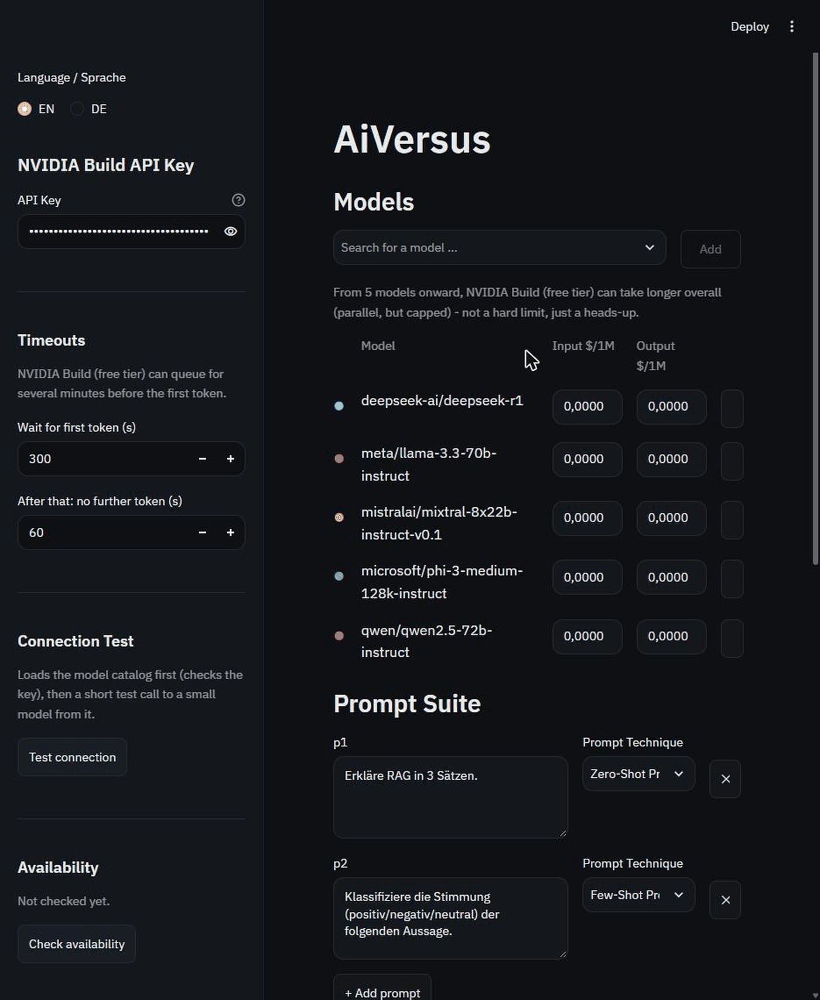

# AiVersus

AiVersus is an open-source tool to compare large language models side by side. Add any
number of models from [NVIDIA Build](https://build.nvidia.com), run the same prompts
against all of them in parallel, and compare the answers, timing, tokens, and cost -
optionally grounded in your own documents via RAG. Runs locally in your browser.

*(🇩🇪 Deutsche Version: [README.de.md](README.de.md))*



## Features

- **Any number of models, side by side** - search the live NVIDIA Build catalog, add as
  many models as you like, remove them again; each gets a stable colour.
- **Parallel benchmark runs** with a live status line per model/prompt (queue, generating,
  done, error, timeout, cancelled) and a **Stop** button that cancels cleanly - finished
  answers are kept, nothing already saved is lost.
- **Metrics per answer**: time to first token (TTFT, includes NVIDIA's queue), pure
  generation time, input/output tokens, reasoning tokens (for reasoning models), tokens
  per second, and cost - plus the parameters actually sent (a model that rejects one, e.g.
  `seed`, is retried once without it, and that's shown).
- **Rating**: mark the best answer per prompt and give 1-5 stars per answer; both are
  saved alongside the run.
- **Timeline**: every run is stored locally (`runs.db`); compare latency, tokens, or cost
  across models over time, plus a "wins per model" chart from your ratings.
- **Availability check**: a one-click mini-call to every catalog model tells you which
  ones are actually reachable for your account right now (cached in `availability.json`).
- **LLM pricing table**: your own editable price list (`pricing.json`) - only prices you
  can verify on an official provider page, with source and date; unknown stays unknown,
  never silently "free".
- **RAG (optional)**: upload PDF/TXT/MD documents, build a local index (ChromaDB),
  embeddings run through NVIDIA Build too - no separate provider needed.
- **English or German UI**, English by default, switchable in the sidebar.
- **Your API key never leaves your browser session** - not logged, not saved to disk,
  not included in any export.

## Installation

Requires [uv](https://docs.astral.sh/uv/) and Python 3.11+.

```bash
uv sync
```

## Start

```bash
uv run streamlit run app.py
```

Enter your NVIDIA Build API key in the sidebar (get one for free at
[build.nvidia.com](https://build.nvidia.com) - the free tier is generous, but **expect a
queue of up to several minutes before the first token** on a busy model; the app accounts
for that with a long default timeout, which you can adjust in the sidebar).

## Usage

1. Enter your API key, test the connection, then add one or more models in **Models**.
2. Write one or more prompts in the **Prompt Suite**. The two shipped default
   prompts show the difference between the technique labels: `p1` is
   zero-shot (a direct question, no examples), `p2` is genuine few-shot - a
   sentiment-classification prompt (positive/negative/neutral) with three
   worked examples before the model has to label the final, unlabelled
   statement. Only set the label when it actually fits the prompt.
3. Set the shared **Parameters** (temperature, top_p, max_tokens - default 4096, raise it
   if a card shows the "Truncated" badge - optional system prompt, optional fixed seed).
4. Click **Start benchmark**. Results appear as cards per prompt as soon as each model
   finishes; rate the best answer and give stars if you like.
5. Export results as CSV or JSON, or browse the **Timeline** for past runs.

## RAG (optional)

Enable "Use RAG context" in the sidebar, pick an embedding model from the live catalog,
upload documents (PDF, TXT, MD), and build the index. The most relevant chunks are
retrieved once per prompt (not once per model) and added as context; each result card
shows whether context was injected and which chunks were used. The index is stored
locally in `rag_store/`.

## Privacy

Your API key lives only in the browser session's memory for as long as the app is open.
It is never written to disk, never logged, and never included in exports (CSV/JSON) or in
`runs.db`.

## Project files

- `runs.db`, `rag_store/`, `availability.json` - local, per-user state, not committed.
- `pricing.json` - your own curated, sourced price list; committed, since it is reference
  data meant to travel with the project (but only ever contains prices you verified).

---

© 2026 Airdinsh (Erdinç Arslan) · Masterschool AI Engineering Track · MIT License (see
[LICENSE](LICENSE))
📧 Signlab@gmx.de · 🌐 [Airdinsh.com](https://Airdinsh.com)
